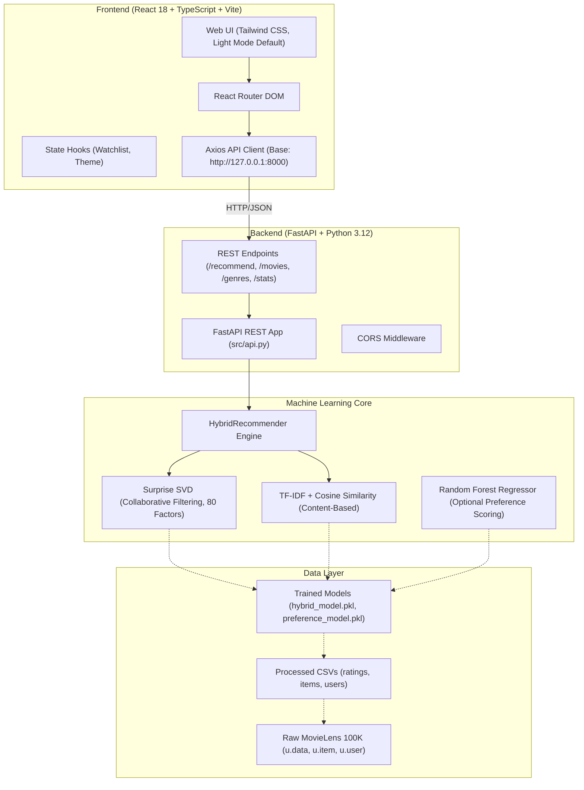
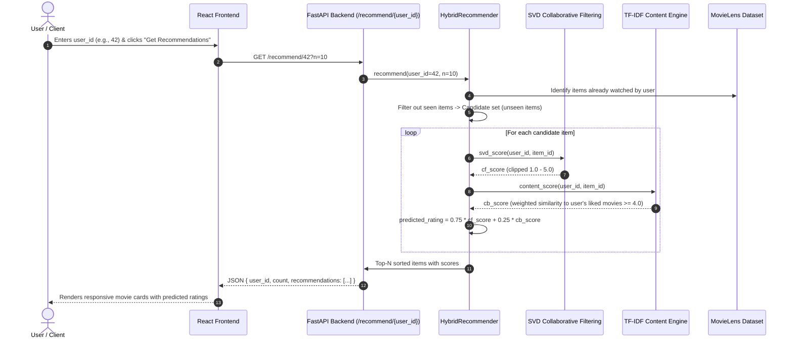
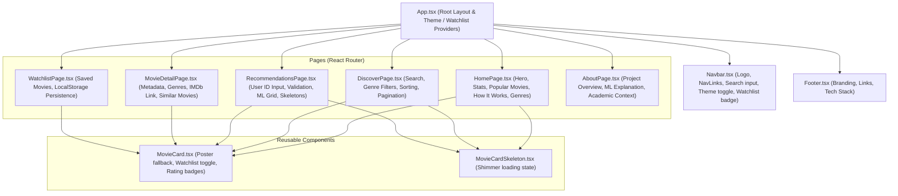

# RecomMind — System Architecture

This document describes the end-to-end architecture of **RecomMind**, a modern AI-powered personalized movie recommendation system built on the MovieLens 100K dataset.

---

## 1. High-Level Architecture Overview

---

## 2. Recommendation Generation Dataflow

---

## 3. Frontend Component Structure

---

## 4. Key Design Decisions

1. **Light Mode by Default**: Tailored with clean visual hierarchy, purple/blue accents, white surfaces, subtle borders, and accessible contrast. An optional dark mode toggle is available with `localStorage` persistence.
2. **Real Model Integration**: The frontend connects directly to `FastAPI` which uses the serialized `HybridRecommender` trained on 100,000 real ratings.
3. **Graceful Fallbacks**: Missing posters are automatically rendered as custom SVG placeholders with initials and deterministic color gradients derived from the movie title.
4. **Resilient Architecture**: Both FastAPI (`src/api.py`) and legacy Flask (`src/app.py`) are supported side-by-side.
