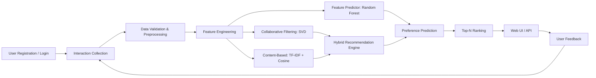

# System Architecture

## Data flow
1. User interactions are collected as explicit ratings or implicit events.
2. Data are cleaned, deduplicated and transformed.
3. User/item features are generated.
4. SVD learns latent user/item factors.
5. TF-IDF represents item content and cosine similarity measures content affinity.
6. The hybrid engine combines collaborative and content scores.
7. Candidate items are ranked and Top-N recommendations are returned.
8. Feedback becomes a new interaction event for future retraining or online updates.
